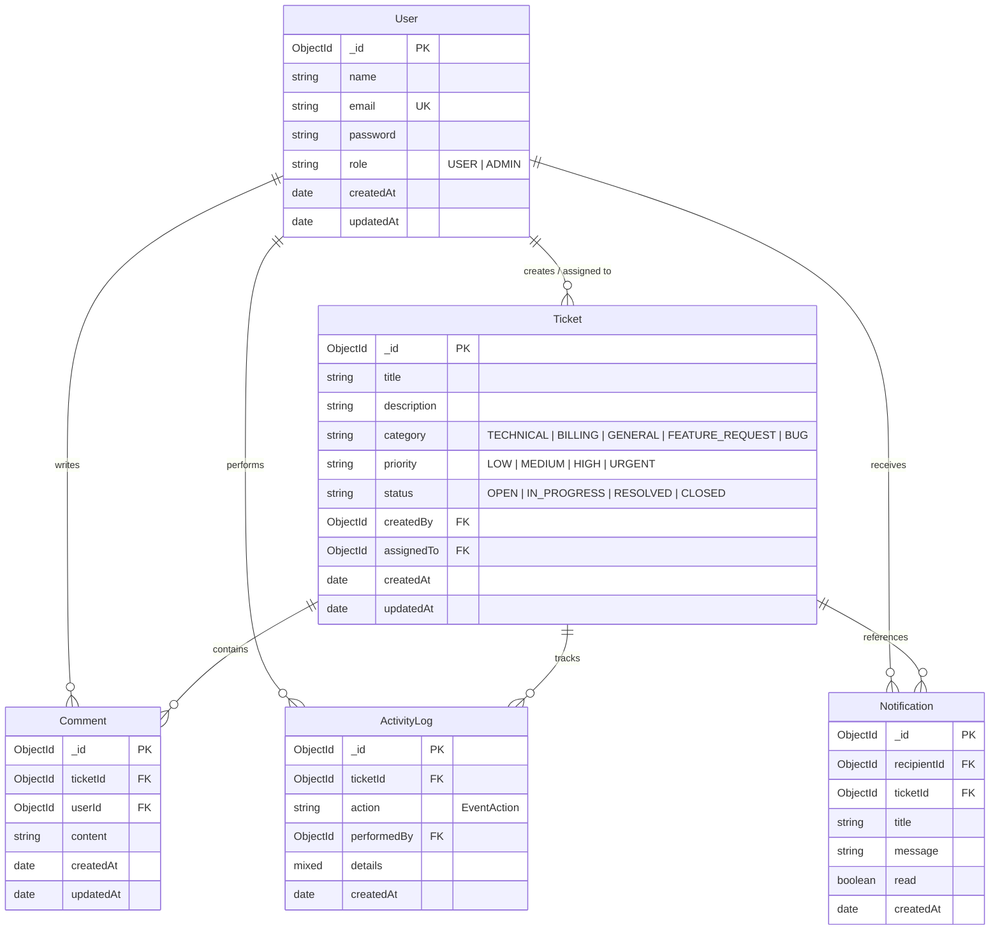

# TicketFlow - Support Ticket Management System

**TicketFlow** is a production-grade Mini Helpdesk and Ticket Management System developed with **Node.js**, **Express.js**, **TypeScript**, and **MongoDB**, featuring JWT role-based access control, event-driven action management, audit trails, and an administrator analytics dashboard.

---

## Table of Contents

1. [Features](#features)
2. [Architecture & Design Decisions](#architecture--design-decisions)
3. [Technology Stack](#technology-stack)
4. [Database Design](#database-design)
5. [Event-Driven Workflow & Action Management](#event-driven-workflow--action-management)
6. [API Documentation](#api-documentation)
7. [Getting Started & Installation](#getting-started--installation)
8. [Automated Testing](#automated-testing)
9. [Project Structure](#project-structure)

---

## 1. Features

- **Robust Authentication & RBAC:**
  - Secure registration and login using JWT (JSON Web Tokens).
  - Passwords hashed using `bcryptjs` with 10 salt rounds.
  - Role-Based Access Control enforcing two primary roles: `USER` and `ADMIN`.
- **Comprehensive Ticket Management:**
  - Users create support tickets with title, description, category, and priority.
  - Multi-status lifecycle: `OPEN` -> `IN_PROGRESS` -> `RESOLVED` -> `CLOSED`.
  - Categories: `TECHNICAL`, `BILLING`, `GENERAL`, `FEATURE_REQUEST`, `BUG`.
  - Priority levels: `LOW`, `MEDIUM`, `HIGH`, `URGENT`.
  - Filtering, search (regex on title/description), sorting, and pagination.
  - Strict ownership rules: users only manage their own tickets; admins oversee all tickets.
  - Safe deletion rules: users can only delete their own `OPEN` tickets (cannot delete tickets in progress or resolved).
- **Interactive Comments:**
  - Ticket creators and administrators collaborate via threaded comments.
- **Event-Driven Architecture:**
  - Asynchronous event bus (`EventEmitter`) decoupling core business logic from audit logging and notifications.
  - Automatic activity log capture for: `TICKET_CREATED`, `TICKET_UPDATED`, `STATUS_CHANGED`, `PRIORITY_CHANGED`, `COMMENT_ADDED`, `TICKET_RESOLVED`, `TICKET_DELETED`.
  - In-app notification delivery to affected users and administrators.
- **Admin Analytics Dashboard:**
  - Aggregated metrics across ticket status, priority distribution, category breakdown, user counts, and recent activity feeds.
- **Zero-Friction Local Execution:**
  - Automatically boots an embedded in-memory MongoDB instance (`mongodb-memory-server`) if no external `MONGODB_URI` is provided, enabling instant evaluation without configuring database clusters.

---

## 2. Architecture & Design Decisions

The application adheres to clean architecture principles:

```
[ HTTP Requests ]
       │
       ▼
[ Middlewares: CORS, JSON Body Parser ]
       │
       ▼
[ Authentication & RBAC Guards ] ── (JWT Verification & Role Check)
       │
       ▼
[ Input Validation (Zod) ] ── (Rejects invalid schemas with 400 Bad Request)
       │
       ▼
[ Controllers ] ── (Encapsulates business rules and state changes)
       │
       ├────────────────────────┐
       ▼                        ▼
[ Mongoose Models ]     [ Event Bus (EventEmitter) ]
       │                        │
       ▼                        ├───────────────────────┐
[ MongoDB Database ]            ▼                       ▼
                        [ Activity Log Listener ]  [ Notification Listener ]
```

### Key Engineering Decisions:
- **Separation of Concerns:** Business logic lives in controllers; validation is encapsulated in schemas; events handle non-blocking side-effects.
- **Strict Typing:** All data shapes, request payloads, query parameters, and database documents are typed with TypeScript (`strict: true`, `NodeNext` ESM module resolution).
- **Asynchronous Decoupling:** Emitting domain events instead of directly inlining audit log creation in the controller prevents notification failures or slow logging from degrading API response times.

---

## 3. Technology Stack

- **Runtime:** Node.js (v24 LTS / v20+)
- **Framework:** Express.js 5
- **Language:** TypeScript 5.8+ (Strict ES2022 / NodeNext)
- **Database & ODM:** MongoDB with Mongoose 9
- **Validation:** Zod
- **Security:** bcryptjs, jsonwebtoken, cors
- **Testing:** Vitest, Supertest, mongodb-memory-server

---

## 4. Database Design



### Indexing Strategy
- `User.email`: Unique index for fast O(1) credential lookups.
- `Ticket.status`, `Ticket.priority`, `Ticket.category`: Single-field indexes for filter queries.
- `Ticket.createdBy`: Index for fast user ticket retrieval.
- `Comment.ticketId`: Index for ticket comment threading.
- `ActivityLog.ticketId`, `ActivityLog.createdAt`: Compound indexes for audit log queries.
- `Notification.recipientId`, `Notification.read`: Index for notification feed retrieval.

---

## 5. Event-Driven Workflow & Action Management

The system leverages a centralized `AppEventBus` (extending Node.js `EventEmitter`):

| Trigger Event | Source Action | Listener Action 1 (Audit Log) | Listener Action 2 (Notifications) |
|---|---|---|---|
| `TICKET_CREATED` | User creates ticket | Logs ticket title, category, priority, status | Notifies all administrators of incoming ticket |
| `TICKET_UPDATED` | User or admin edits ticket | Records field changes in ActivityLog | None |
| `STATUS_CHANGED` | Admin changes status | Records `previousStatus` and `newStatus` | Notifies ticket creator of status update |
| `PRIORITY_CHANGED`| Admin updates priority | Records `previousPriority` and `newPriority` | None |
| `TICKET_RESOLVED`| Status marked as `RESOLVED` | Records resolution timestamp | Sends celebration notification to creator |
| `COMMENT_ADDED`  | User or Admin adds comment | Records comment excerpt and commentId | Cross-notifies the opposite party |
| `TICKET_DELETED` | User or Admin deletes ticket | Records ticket deletion record | None |

---

## 6. API Documentation

### Base URL: `http://localhost:5000`

### Authentication (`/api/auth`)
- `POST /api/auth/register` - Register a new user (`name`, `email`, `password`, optional `role: "USER" | "ADMIN"`).
- `POST /api/auth/login` - Authenticate with `email` and `password`, returns JWT token.
- `GET /api/auth/me` - Get profile of authenticated user (`Bearer <token>`).

### Tickets (`/api/tickets`)
- `POST /api/tickets` - Create a ticket (`title`, `description`, `category`, optional `priority`).
- `GET /api/tickets` - List tickets.
  - Query params: `page`, `limit`, `status`, `priority`, `category`, `search`, `sortBy`, `sortOrder`.
  - Normal users receive their tickets; Admins receive all tickets.
- `GET /api/tickets/:id` - Get ticket details and assigned user.
- `PUT /api/tickets/:id` - Update ticket details (Users can edit open tickets; Admins can edit any).
- `PATCH /api/tickets/:id/status` - (Admin only) Update status, priority, or assignment (`status`, `priority`, `assignedTo`).
- `DELETE /api/tickets/:id` - Delete ticket (Users can delete their own `OPEN` tickets; Admins can delete any).

### Comments (`/api/tickets/:ticketId/comments`)
- `POST /api/tickets/:ticketId/comments` - Add a comment (`content`).
- `GET /api/tickets/:ticketId/comments` - Retrieve all comments chronologically for the ticket.

### Admin Dashboard & Audit (`/api/admin`)
- `GET /api/admin/stats` - (Admin only) Overall statistics (status/priority/category counts, recent activity).
- `GET /api/admin/activities` - (Admin only) Filterable, paginated audit logs.
- `GET /api/admin/users/:userId/tickets` - (Admin only) Inspect tickets of a specific user.

### Notifications (`/api/notifications`)
- `GET /api/notifications` - Get notifications for the authenticated user.
- `PATCH /api/notifications/:id/read` - Mark a notification as read.

---

## 7. Getting Started & Installation

### Prerequisites
- Node.js 20+ (tested on Node v24)
- npm or pnpm

### Setup Steps
1. Clone the repository and enter the directory:
   ```bash
   git clone https://github.com/Yashh56/TicketFlow.git
   cd TicketFlow
   ```

2. Install dependencies:
   ```bash
   npm install
   ```

3. Environment Configuration:
   Create a `.env` file based on `.env.example`:
   ```bash
   cp .env.example .env
   ```
   *Note: If `MONGODB_URI` is left blank, the app will automatically boot an in-memory MongoDB instance!*

4. Build the TypeScript project:
   ```bash
   npm run build
   ```

5. Start the development server:
   ```bash
   npm run dev
   ```
   Or production:
   ```bash
   npm start
   ```

---

## 8. Automated Testing

The project includes an end-to-end integration test suite using **Vitest** and **Supertest** running against an isolated in-memory MongoDB instance:

```bash
npm test
```

### Verified Scenarios (27 Integration Tests):
- Health check route integrity.
- User and Admin registration, duplicate email rejection, login validation, and profile access.
- Ticket creation, RBAC isolation (preventing unauthorized user reads), updating, and listing.
- Multi-criteria filtering, keyword text search, and pagination.
- Admin status updates and ticket assignment.
- Threaded comments by user and admin responses.
- Asynchronous domain event firing and activity log creation.
- In-app notification delivery upon resolution and comments.
- Deletion guards (preventing users from deleting non-open tickets) and admin deletion privileges.

---

## 9. Project Structure

```
TicketFlow/
├── src/
│   ├── config/
│   │   └── database.ts              # Database connection manager with in-memory fallback
│   ├── controllers/
│   │   ├── admin.controller.ts      # Dashboard analytics & audit logs
│   │   ├── auth.controller.ts       # Registration, login, profile
│   │   ├── comment.controller.ts    # Threaded comments
│   │   ├── notification.controller.ts # User notifications
│   │   └── ticket.controller.ts     # Ticket lifecycle operations
│   ├── events/
│   │   ├── eventBus.ts              # Typed EventEmitter singleton
│   │   ├── index.ts                 # Listener registration
│   │   └── listeners/
│   │       ├── activityLog.listener.ts   # Writes audit logs on events
│   │       └── notification.listener.ts  # Dispatches user/admin notifications
│   ├── middlewares/
│   │   ├── auth.middleware.ts       # JWT verification & RBAC authorization
│   │   └── validate.middleware.ts   # Zod request validation wrapper
│   ├── models/
│   │   ├── ActivityLog.model.ts     # Audit log schema
│   │   ├── Comment.model.ts         # Ticket comments schema
│   │   ├── Notification.model.ts    # In-app notifications schema
│   │   ├── Ticket.model.ts          # Core ticket schema
│   │   ├── User.model.ts            # User & credentials schema
│   │   └── index.ts                 # Centralized model exports
│   ├── routes/
│   │   ├── admin.routes.ts          # Admin dashboard routes
│   │   ├── auth.routes.ts           # Authentication routes
│   │   ├── comment.routes.ts        # Comment routes
│   │   ├── notification.routes.ts   # Notification routes
│   │   └── ticket.routes.ts         # Ticket routes
│   ├── types/
│   │   └── index.ts                 # Enums, interfaces, and auth types
│   ├── utils/
│   │   ├── jwt.ts                   # Token generation and verification
│   │   └── password.ts              # Bcrypt password hashing
│   ├── app.ts                       # Express app configuration & middleware mounts
│   └── index.ts                     # Server entry point
├── tests/
│   └── integration.test.ts          # 27 comprehensive E2E integration tests
├── .env.example                     # Environment template
├── package.json                     # Scripts & dependencies
├── postman_collection.json          # Importable Postman collection
├── tsconfig.json                    # Strict TypeScript configuration
└── vitest.config.ts                 # Test runner configuration
```
